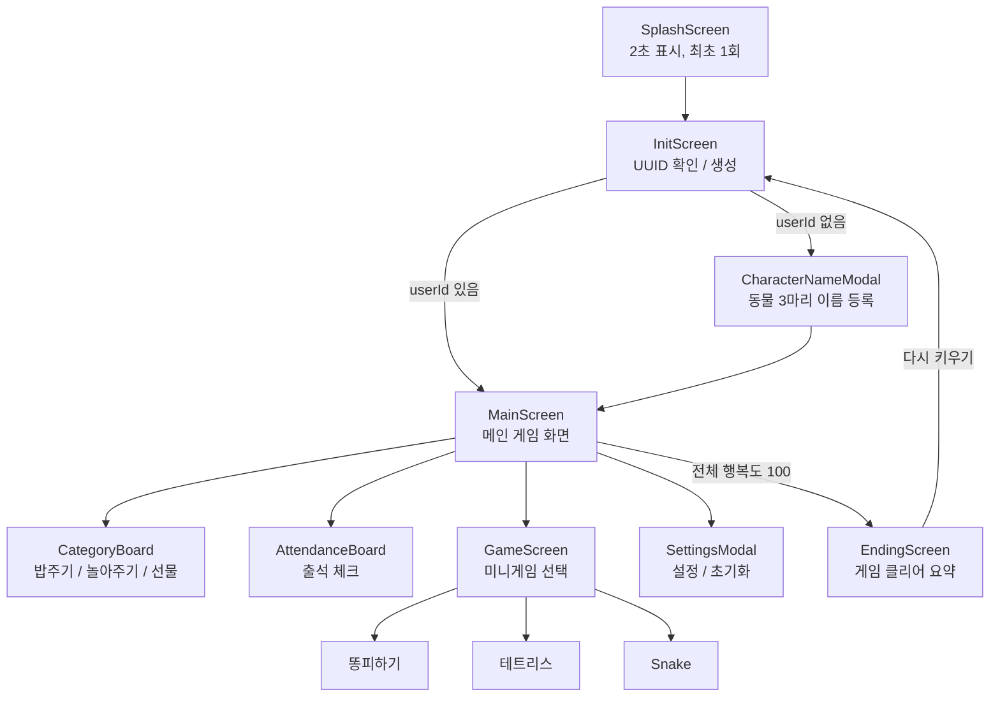
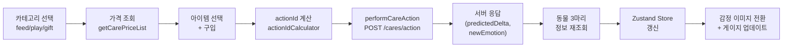
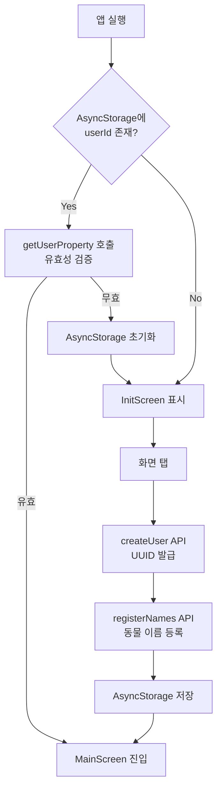
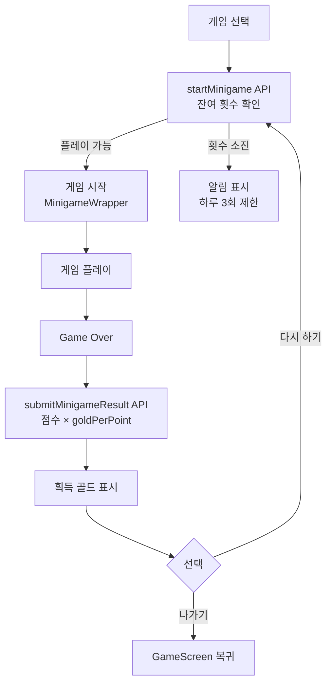

# No-So-Gong (NSG) Frontend

ML 기반 감정 예측 동물 육성 시뮬레이션 게임의 React Native + Expo 클라이언트

## 목차

- [팀원 소개](#팀원-소개)
- [프로젝트 소개](#프로젝트-소개)
- [주요 기능](#주요-기능)
- [기술 스택](#기술-스택)
- [게임 흐름](#게임-흐름-architecture)
- [화면 구성](#화면-구성)
- [API 연동](#api-연동)
- [상태 관리](#상태-관리)
- [시작하기](#시작하기)
- [환경 설정](#환경-설정)
- [프로젝트 구조](#프로젝트-구조)

## 팀원 소개

| Chaehyunlim | DooYee | kimtaeyeon04 |
|:---:|:---:|:---:|
|  |  |  |
| [@Chaehyunli](https://github.com/Chaehyunli) | [@DOOYEE0709](https://github.com/DOOYEE0709) | [@kimtaeyeon04](https://github.com/kimtaeyeon04) |

## 프로젝트 소개

**No-So-Gong (노소공)** 팀의 육성 시뮬레이션 게임 **'노답 삼형제! 이걸 키우라고?'** 의 프론트엔드 클라이언트입니다. 세 마리 동물(시바견, 오리, 병아리)을 케어하며 모두 행복도 100을 달성하는 것을 목표로 합니다.

백엔드의 **XGBoost 기반 ML 모델**이 예측한 감정 변화량(`predictedDelta`)을 수신하여 동물의 표정 이미지와 감정 게이지를 실시간으로 반영하며, **UUID 기반 비로그인 인증**으로 별도의 회원가입 없이 즉시 플레이할 수 있습니다.

## 주요 기능

### ML 감정 예측 결과 반영

케어 행동 수행 시 백엔드 ML 모델의 예측 결과를 수신하여 UI에 반영합니다.

**서버 응답 데이터:**

| 필드 | 설명 |
|------|------|
| `predictedDelta` | ML 모델이 예측한 감정 변화량 |
| `previousEmotion` | 행동 수행 전 감정 수치 |
| `newEmotion` | 행동 수행 후 감정 수치 |
| `actionPerformed` | 수행된 행동명 |
| `message` | 반응 메시지 |

**감정 수치별 동물 이미지 매핑:**

| 감정 범위 | 이미지 | 표현 |
|-----------|--------|------|
| 0 ~ 9 | image1 | 매우 슬픔 |
| 10 ~ 29 | image2 | 슬픔 |
| 30 ~ 49 | image3 | 보통 |
| 50 ~ 69 | image4 | 기쁨 |
| 70 ~ 89 | image5 | 매우 기쁨 |
| 90 ~ 100 | image6 | 최고 행복 |

케어 행동 후 갱신된 `newEmotion` 값에 따라 동물의 표정 이미지가 자동 전환되며, 메인 화면의 감정 게이지(하트)와 편애도 게이지가 실시간으로 업데이트됩니다.

### UUID 기반 비로그인 인증

별도의 회원가입/로그인 없이 기기 단위로 사용자를 식별합니다.

**인증 흐름:**

```
1. 최초 실행 → createUser() API 호출 → 서버에서 UUID 발급
2. AsyncStorage에 userId 영구 저장
3. 이후 모든 API 요청 시 'user-id' 헤더에 UUID 첨부
4. 앱 재실행 시 AsyncStorage에서 userId 복원 → 자동 로그인
```

**세션 유효성 검증:** 앱 진입 시 `getUserProperty(userId)` 호출로 서버에 저장된 유저 존재 여부를 확인하고, 유효하지 않으면 AsyncStorage를 초기화하여 재등록을 유도합니다.

### 미니게임 3종

재화를 획득하기 위한 3종의 미니게임을 제공합니다. 각 게임은 하루 최대 3회 플레이 가능합니다.

#### 1. 똥피하기 (gameId: 1)

| 항목 | 내용 |
|------|------|
| 조작 | 좌/우 버튼 (길게 누르면 연속 이동) |
| 목표 | 화면 위에서 떨어지는 똥을 피해 생존 |
| 점수 | 화면 아래로 통과한 똥 1개당 +1점 |
| 보상 | 점수당 **2원** |
| 난이도 | 10초마다 낙하 속도 및 생성 빈도 증가 |
| 종료 | 똥과 충돌 시 Game Over |

- 60 FPS 게임 루프 기반
- 현재 선택된 동물 캐릭터가 플레이어로 표시
- 충돌 판정에 10px 패딩 적용

#### 2. 테트리스 (gameId: 2)

| 항목 | 내용 |
|------|------|
| 조작 | 좌/우 이동, 회전, 소프트 드롭, 하드 드롭 |
| 보드 | 10 x 19 그리드 |
| 점수 | 줄 클리어당 20점 |
| 보상 | 점수 / 2 = **획득 원** |
| 난이도 | 10줄 클리어마다 레벨업, 낙하 속도 증가 |
| 종료 | 블록이 상단에 도달 시 Game Over |

- 7종 테트로미노 (I, O, T, S, Z, J, L) 각각 고유 색상
- Next 블록 미리보기 지원
- 사이드 패널에 현재 동물 이미지 표시

#### 3. Snake 게임 (gameId: 3)

| 항목 | 내용 |
|------|------|
| 조작 | 상/하/좌/우 방향 버튼 |
| 보드 | 15 x 21 그리드 |
| 점수 | 하트(먹이) 획득 시 +10점 |
| 보상 | 점수당 **1원** |
| 종료 | 벽 또는 자기 몸과 충돌 시 Game Over |

- 뱀의 각 마디가 현재 동물의 감정 이미지(6종)로 랜덤 표시
- 200ms 간격 게임 루프 (초당 5회 이동)
- 역방향 전환 방지 처리

**미니게임 공통 래퍼 (`MinigameWrapper`):**
- 게임 시작 시 서버에 `startMinigame()` 호출 → 잔여 횟수 확인
- 게임 종료 시 `submitMinigameResult()` 호출 → 점수 및 보상 저장
- 결과 화면에서 획득 골드 표시, "다시 하기" / "나가기" 선택

### 케어(Care) 시스템

3개 카테고리의 아이템을 구매하여 동물을 케어합니다.

| 카테고리 | Level 1 | Level 2 | Level 3 |
|----------|---------|---------|---------|
| 놀아주기 (play) | 산책 가기 | 공 놀이 | 애견 카페 가기 |
| 밥주기 (feed) | 시장 사료 | 마트 사료 | 유기농 사료 |
| 선물하기 (gift) | 장난감 사주기 | 예쁜 옷 사주기 | 유모차 사주기 |

**구매 흐름:**
1. 카테고리 버튼 탭 → `CategoryBoard` 모달 오픈
2. 서버에서 현재 진화 단계에 맞는 가격 조회 (`getCarePriceList`)
3. 아이템 선택 → 구입 버튼 → `actionId` 계산 후 `performCareAction` 호출
4. 응답의 감정 변화 반영 → **3마리 동물 전체** 정보 재조회 (편애도 연쇄 변동)
5. 재화 및 감정 게이지 UI 갱신

**actionId 계산 공식:**
```
play: baseId(1)  + (stage-1)*3 + (itemId-1) → 1~9
feed: baseId(10) + (stage-1)*3 + (itemId-1) → 10~18
gift: baseId(19) + (stage-1)*3 + (itemId-1) → 19~27
```

### 출석 체크

7일 주기 순환 출석 보상 시스템입니다.

- 7일 보드 형태의 출석 캘린더 표시
- 출석 완료일은 반투명 처리 (opacity 0.5)
- "보상받기" 버튼으로 당일 보상 수령 (30~40원)
- 중복 출석 방지 (409 응답 처리)

### 게임 클리어 및 초기화

- 3마리 동물 모두 `진화 3단계` + `감정 100 이상` 도달 시 자동으로 엔딩 화면 진입
- 엔딩 요약 정보: 총 플레이 일수, 소비 코인, 가출 횟수, 연속 출석 일수
- "다시 키우기" 버튼으로 전체 데이터 초기화 후 재시작

## 기술 스택

### Core

- **React Native** 0.81 - 크로스 플랫폼 모바일 프레임워크
- **Expo** ~54.0 - 빌드 및 배포 도구
- **TypeScript** - 정적 타입 시스템
- **React** 19.1 - UI 라이브러리

### Navigation

- **React Navigation** (Native Stack) - 화면 전환 관리

### State Management

- **Zustand** 5.0 - 경량 전역 상태 관리
- **AsyncStorage** - 기기 로컬 영구 저장소 (userId 보관)

### Network

- **Axios** 1.10 - HTTP 클라이언트 (백엔드 API 통신)

### UI / Styling

- **expo-linear-gradient** - 그라데이션 게이지 바
- **react-native-svg** - SVG 아이콘 렌더링
- **react-native-vector-icons** - MaterialCommunityIcons 사용
- **react-native-safe-area-context** - 노치 대응 레이아웃

### Game Engine

- **react-native-game-engine** - 미니게임 3종 구현

### Fonts

- **BagelFatOne-Regular** - UI 버튼 및 라벨
- **Dokdo-Regular** - 게임 내 텍스트

## 게임 흐름 (Architecture)

### 전체 화면 네비게이션



### 케어 행동 및 ML 감정 반영 흐름



### UUID 인증 및 세션 흐름



### 미니게임 플레이 흐름



## 화면 구성

### SplashScreen

- 스플래시 이미지 2초 표시 후 자동 전환
- Zustand persist 미들웨어로 최초 1회만 노출

### InitScreen

- 배경: 삼형제 캐릭터 이미지 + 깜빡이는 안내 텍스트
- 화면 탭 시 `CharacterNameModal` 오픈 (신규 유저) 또는 MainScreen 이동 (기존 유저)
- 동물 이름 입력: 시바견, 병아리, 오리 각 최대 10자

### MainScreen

- **상단 게이지:** 감정(하트 아이콘), 편애도(친구 아이콘), 재화(코인)
- **중앙:** 가로 스와이프 FlatList로 동물 3마리 순환 표시, 감정 수치에 따라 표정 자동 변경
- **좌측 버튼:** 설정, 미니게임, 출석 체크
- **하단 버튼:** 놀아주기, 밥주기, 선물하기 (각각 CategoryBoard 모달 오픈)

### GameScreen

- 3종 미니게임 선택 모달 (배경 이미지 카드 형태)
- 각 게임 탭 시 잔여 횟수 확인 후 진입

### EndingScreen

- 게임 클리어 요약 통계 표시
- "다시 키우기" 버튼 → 데이터 초기화 후 재시작

## API 연동

모든 API 요청은 `user-id` 헤더에 UUID를 첨부하며, Axios를 통해 통신합니다.

### Users (`/api/v1/users`)

| Method | Endpoint | 설명 |
|--------|----------|------|
| POST | `/start` | 유저 생성 (UUID 발급) |
| GET | `/property` | 현재 잔액 조회 |
| PATCH | `/property/money` | 재화 수정 |
| POST | `/transactions` | 트랜잭션 생성 |

### Pets (`/api/v1/pets`)

| Method | Endpoint | 설명 |
|--------|----------|------|
| POST | `/nickname` | 동물 3마리 닉네임 등록 |
| GET | `/{animalId}` | 동물 상세 정보 조회 (감정, 진화, 편애도) |

### Cares (`/api/v1/cares`)

| Method | Endpoint | 설명 |
|--------|----------|------|
| POST | `/action` | ML 기반 케어 행동 수행 및 감정 예측 결과 수신 |
| GET | `/pricelist` | 카테고리별 행동 가격 조회 (진화 단계 반영) |

### Events (`/api/v1/events`)

| Method | Endpoint | 설명 |
|--------|----------|------|
| GET | `/attendance` | 7일 출석 현황 조회 |
| POST | `/attendance/checkin` | 출석 체크 및 보상 수령 |

### Minigames (`/api/v1/minigames`)

| Method | Endpoint | 설명 |
|--------|----------|------|
| POST | `/{gameId}/start` | 미니게임 시작 (일일 3회 제한 확인) |
| POST | `/{gameId}/result` | 미니게임 결과 저장 및 보상 지급 |

### Endings (`/api/v1/endings`)

| Method | Endpoint | 설명 |
|--------|----------|------|
| GET | `/summary` | 게임 클리어 요약 (전체 동물 행복도 100 필요) |
| POST | `/reset` | 유저 및 관련 데이터 전체 초기화 |

## 상태 관리

Zustand를 사용하여 6개의 독립 Store로 전역 상태를 관리합니다.

| Store | 역할 | 주요 상태 | 영구 저장 |
|-------|------|-----------|-----------|
| `useUserStore` | 유저 인증 | `userId` | AsyncStorage |
| `usePetStore` | 동물 정보 | `petsInfo`, `currentPetId`, `currentPetImage` | - |
| `useMoneyStore` | 재화 관리 | `money` | - |
| `usePriceListStore` | 가격 캐싱 | `pricesByCategory`, `cache` | - |
| `useLoadingStore` | 로딩 상태 | `isLoading` | - |
| `useSplashStore` | 스플래시 제어 | `isSplashShown`, `hasShownSplash` | AsyncStorage (persist) |

**가격 캐싱 전략:** `usePriceListStore`는 `category:animalId:evolutionStage` 형태의 키로 가격 데이터를 캐싱하여 동일 조건의 반복 API 호출을 방지합니다.

## 시작하기

### 필수 요구사항

- Node.js 18 이상
- npm 또는 yarn
- Expo CLI (`npx expo`)
- iOS: Expo Go 앱 / Android: Expo Go 앱
- 백엔드 서버 실행 중 (FastAPI + PostgreSQL)

### 설치 및 실행

1. **저장소 클론**
```bash
git clone https://github.com/no-so-gong/nsg-frontend.git
cd nsg-frontend
```

2. **의존성 설치**
```bash
npm install
```

3. **환경 변수 설정**
```bash
# .env 파일 생성 (.env.example 참고)
API_URL=http://<your-ipv4-address>:8000
```
- `<your-ipv4-address>`는 호스트 컴퓨터의 IPv4 주소입니다.
- Windows: `cmd` → `ipconfig` → IPv4 주소 확인
- `localhost` / `127.0.0.1`은 모바일 기기에서 접근 불가합니다.

4. **앱 실행**
```bash
# 모바일 (Expo Go)
npx expo start

# 웹 실행
npx expo install react-dom react-native-web @expo/metro-runtime
npx expo start --web

# 캐시 초기화 실행 (문제 발생 시)
npx expo start --clear
```

## 환경 설정

### 필수 환경 변수

`.env` 파일을 프로젝트 루트에 생성합니다.

```properties
# Backend API URL (호스트 IPv4 주소 사용)
API_URL=http://192.168.0.x:8000
```

`app.config.ts`에서 `dotenv`를 통해 환경 변수를 로드하며, `Constants.expoConfig.extra.API_URL`로 런타임에 접근합니다.

## 프로젝트 구조

```
nsg-frontend/
├── assets/
│   ├── fonts/                        # 커스텀 폰트 (BagelFatOne, Dokdo)
│   ├── icons/                        # 아이콘 리소스 (feed, play, gift, heart 등)
│   └── images/                       # 화면 배경, 동물 이미지 (감정 6단계 × 3종)
│
├── src/
│   ├── apis/                         # Axios 기반 API 요청 모듈
│   │   ├── users.ts                  # 유저 생성, 잔액, 트랜잭션
│   │   ├── pets.ts                   # 동물 닉네임 등록, 상세 조회
│   │   ├── cares.ts                  # ML 케어 행동, 가격 조회
│   │   ├── events.ts                 # 출석 현황, 체크인
│   │   ├── minigames.ts             # 미니게임 시작/결과
│   │   └── endings.ts               # 엔딩 요약, 초기화
│   │
│   ├── components/                   # 공통 UI 컴포넌트
│   │   ├── BoneLabelSvg.tsx          # 뼈다귀 모양 라벨 (모달 헤더)
│   │   ├── CommonButton.tsx          # 공통 버튼
│   │   ├── EmotionAffinityGauge.tsx  # 감정/편애도 게이지 바
│   │   ├── MoneyStatus.tsx           # 재화 표시
│   │   ├── IconActionButton.tsx      # 이미지 아이콘 버튼
│   │   ├── SVGButton.tsx             # 원형 아이콘 버튼
│   │   ├── CharacterNameModal.tsx    # 동물 이름 입력 모달
│   │   ├── CategoryBoard.tsx         # 카테고리별 아이템 구매 모달
│   │   ├── AttendanceBoard.tsx       # 7일 출석 보드
│   │   ├── SettingsModal.tsx         # 설정/초기화 모달
│   │   ├── EndingModal.tsx           # 엔딩 재시작 확인 모달
│   │   ├── minigames/
│   │   │   └── MinigameWrapper.tsx   # 미니게임 공통 래퍼 (생명주기 관리)
│   │   ├── SplashScreen.tsx          # 스플래시 컴포넌트
│   │   ├── LoadingSpinner.tsx        # 전역 로딩 인디케이터
│   │   └── animalImages.ts          # 감정 수치별 동물 이미지 매핑
│   │
│   ├── screens/                      # 화면 단위 구성
│   │   ├── SplashScreen.tsx          # 스플래시 (최초 1회)
│   │   ├── InitScreen.tsx            # 초기 화면 (UUID 생성 + 이름 등록)
│   │   ├── MainScreen.tsx            # 메인 게임 화면 (케어, 게이지, 스와이프)
│   │   └── EndingScreen.tsx          # 게임 클리어 요약
│   │
│   ├── game/                         # 미니게임 구현
│   │   ├── GameScreen.tsx            # 미니게임 선택 화면
│   │   ├── poop/
│   │   │   └── PoopDodgeGame.tsx     # 똥피하기 (60FPS, 충돌 판정)
│   │   ├── tetris/
│   │   │   └── TetrisGame.tsx        # 테트리스 (10×19, 7종 블록)
│   │   └── snake/
│   │       └── SnakeGame.tsx         # Snake (15×21, 동물 이미지 마디)
│   │
│   ├── constants/                    # 전역 상수
│   │   ├── dimensions.ts             # 반응형 화면 크기 상수
│   │   └── endpoints.ts              # API 엔드포인트 경로
│   │
│   └── types/
│       └── navigationTypes.ts        # React Navigation 타입 정의
│
├── config/
│   └── config.ts                     # API_URL 환경 변수 로드
│
├── utils/
│   ├── actionIdCalculator.ts         # 케어 행동 actionId 계산
│   └── fetchWithLoading.ts           # API 호출 시 로딩 자동 처리 래퍼
│
├── zustand/                          # Zustand 전역 상태 Store
│   ├── useUserStore.ts               # userId (AsyncStorage 연동)
│   ├── usePetStore.ts                # 동물 정보 (3마리)
│   ├── useMoneyStore.ts              # 재화 관리
│   ├── usePriceListStore.ts          # 가격 캐싱
│   ├── useLoadingStore.ts            # 로딩 상태
│   └── useSplashStore.ts             # 스플래시 제어 (persist)
│
├── App.tsx                           # 앱 진입점 (Navigation 설정)
├── index.ts                          # 앱 실행 엔트리포인트
├── app.config.ts                     # Expo 설정 (환경 변수 주입)
├── babel.config.js                   # Babel 설정
├── metro.config.js                   # Metro 번들러 설정
├── declarations.d.ts                 # SVG 및 이미지 타입 선언
├── tsconfig.json                     # TypeScript 설정
├── .env.example                      # 환경 변수 예시
└── package.json                      # 프로젝트 메타 및 의존성
```

---

**No-So-Gong** - ML 기반 감정 예측으로 동물과 교감하는 육성 시뮬레이션
